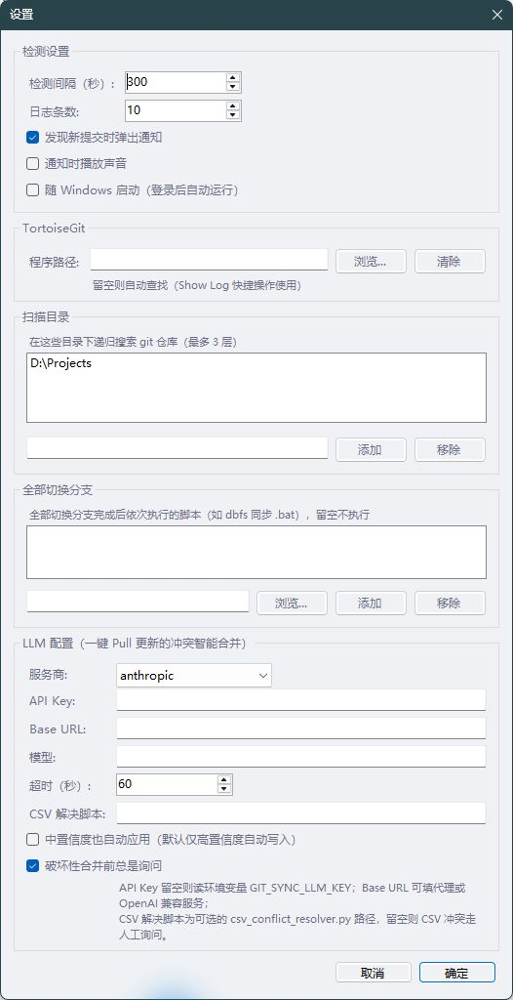
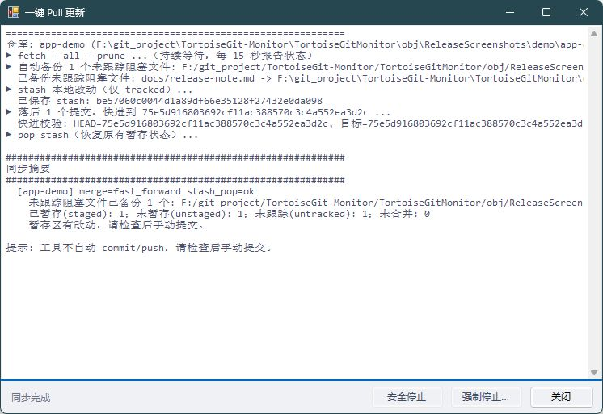

# 安装与运行

## 运行要求

- Windows 10/11，安装 .NET Framework 4.8 或更高的兼容版本。较早的 Windows 10 版本可能需要先安装 [.NET Framework 4.8](https://dotnet.microsoft.com/download/dotnet-framework/net48)。
- Git 已安装且位于 `PATH`，命令行运行 `git --version` 能返回版本。SSH/HTTPS 凭据应先通过普通 Git 配置好。
- [TortoiseGit](https://tortoisegit.org/) 为可选依赖，用于 Show Log 等快捷操作。

## 下载与启动

1. 在 [Releases](https://github.com/StopCodeToTrain/TortoiseGit-Monitor/releases) 下载 `TortoiseGit-Monitor-v1.0.1-windows.zip`。可用该页的 `SHA256SUMS.txt` 核对 ZIP 的 SHA-256。
2. 将 ZIP 完整解压到一个可写的固定目录，例如 `D:\Apps\TortoiseGit-Monitor`。不要直接在压缩包中运行。
3. 保持 `TortoiseGitMonitor.exe` 与 `TortoiseGitMonitor.exe.config` 在同一目录，双击 exe。程序启动后显示在系统托盘，可能位于托盘的折叠区域；没有常驻主窗口。
4. 右键托盘图标 → **设置**，添加需要扫描的父目录并保存。程序最多扫描 3 层。按需调整检测间隔，或启用随 Windows 启动。
5. 使用 **刷新全部** 检查状态。**一键 Pull 更新** 会修改仓库工作区；同步日志窗口显示每个仓库的操作、备份位置和结果。程序不会自动提交或推送。

新安装无需配置 LLM 或 Python 即可完成仓库监控和一键 Pull。

## 从已有版本升级

1. 等待正在进行的同步/分支切换结束，从托盘退出旧程序。不要在 Git 写入期间直接覆盖 exe。
2. 将新版本 exe 和配套 `.exe.config` 一起复制到原安装目录，然后启动。启用了开机自启时应保留安装路径；移动后在设置中重新保存自启选项。
3. 用户配置在 `%USERPROFILE%\.config\tortoisegit_monitor\settings.json`，不在程序目录；升级会继续使用已有配置。同步恢复记录和未跟踪文件备份位于各仓库的 Git 元数据目录，请保留。

## 日志与恢复

- 用户目录下的 `git_sync.log`、`branch_switch.log` 记录对应写操作。
- 未跟踪阻塞文件备份：Git 元数据目录中的 `monitor-untracked-backup/<时间与唯一ID>/files/`，同目录有 `manifest.json`。同步摘要会显示准确路径；linked worktree 的元数据位置可能不同于工作区根目录下的 `.git`。
- 未完成任务记录：Git 元数据目录中的 `monitor-sync-pending.json`。下次同步会核对分支和 stash 后继续；不要在恢复完成前删除记录或其 stash。
- 遇到冲突或恢复状态无法确认时，先检查 `git status`、`git stash list` 和日志，再手动处理。部分改动可能已经恢复，避免反复执行 `stash pop`。

## 界面截图

截图取自 v1.0.0 实际构建的 WinForms 窗口；设置使用示例路径，同步窗口操作本机隔离的演示仓库，不包含个人凭据或业务仓库。





## 已知限制

- 仅支持 Windows；本次发布验证环境为 Windows 11 x64、.NET Framework 4.8 目标框架（运行时 4.8.10008）、Git for Windows 2.55.0.windows.5。未在 Windows 10、Windows ARM 或所有旧 Git 版本上逐一验证。
- 二进制文件未做代码签名，无自动更新器；升级需下载并替换文件。
- 自动检测只执行 fetch 和状态读取；合并、冲突处理、提交和推送不会在后台自动完成。分叉合并和冲突需要人工处理。
- 失效锁清理采用保守检查。其他仓库的 Git 活动、可能早于锁启动的 TortoiseGit 进程或无法确认的状态也会阻止清理；30 秒后仍存在的锁会导致本次任务停止。明确晚于锁两项文件时间的新 TortoiseGit 窗口不再阻止旧锁清理，实际句柄占用仍优先拦截。
- stash 恢复保护会在 stash 栈被外部改动、分支不匹配、改动无法合并或前次恢复结果不明时停止，需要人工检查。不会保证任意重叠改动都能自动合并。
- 未跟踪文件自动备份仅处理阻塞快进的普通文件，拒绝链接、越界路径和嵌套仓库。备份不会自动清理，应在确认内容后自行归档。
- 多个 Monitor 实例的互斥范围是同一 Windows 登录会话；外部 Git/TortoiseGit 仍依赖 Git 自身锁协调，请避免同时在同一仓库进行写操作。
- 设置保留 LLM/CSV 冲突解决配置以兼容旧版；本版本的一键 Pull 遇冲突即停止，不自动调用解决器。
- Git 凭据弹窗、远程认证、网络不可达或后置脚本错误需要用户处理；不保证无人值守时所有仓库都能更新成功。

## 从源码构建与验证

安装 Visual Studio Build Tools 的 .NET 桌面构建组件及 .NET Framework 4.8 目标包：

```bat
MSBuild TortoiseGitMonitor\TortoiseGitMonitor.csproj /p:Configuration=Release
MSBuild tests\RegressionTests.csproj /p:Configuration=Release
TortoiseGitMonitor\obj\RegressionTests\RegressionTests.exe
```

运行文件位于 `TortoiseGitMonitor\bin\Release\`。完整回归在新建的临时仓库中验证快进、锁、备份、多批 stash 恢复及失败场景，结果见 [验证记录](../tests/VERIFICATION.md)。

构建和验证后，可在 PowerShell 执行 `./scripts/Package-Release.ps1` 生成便携 ZIP、包内文件校验清单和 ZIP 的 `SHA256SUMS.txt`。默认输出至被忽略的 `TortoiseGitMonitor/obj/Releases/`；已有同名产物时会拒绝覆盖。
